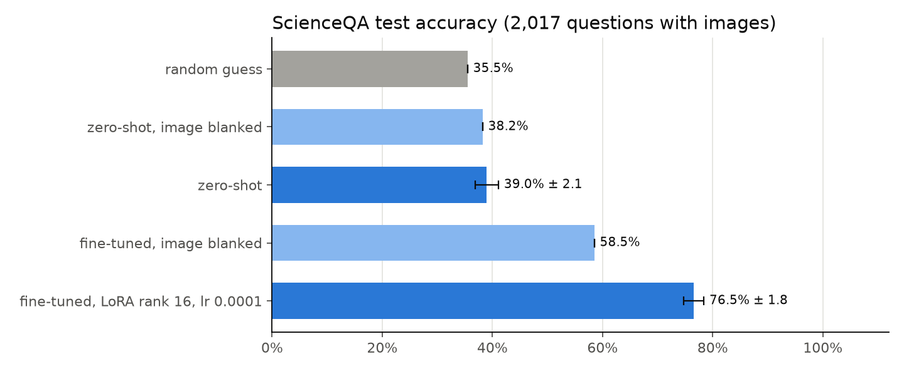
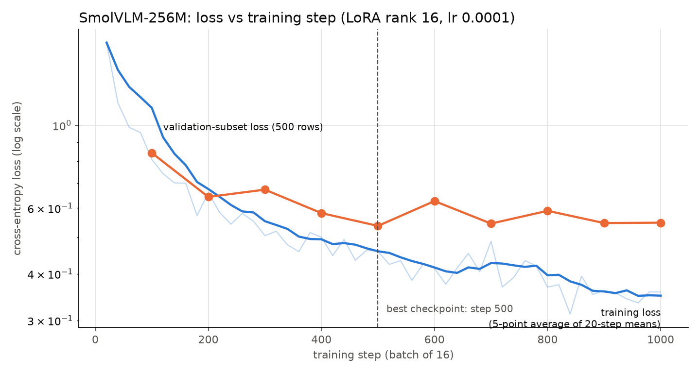
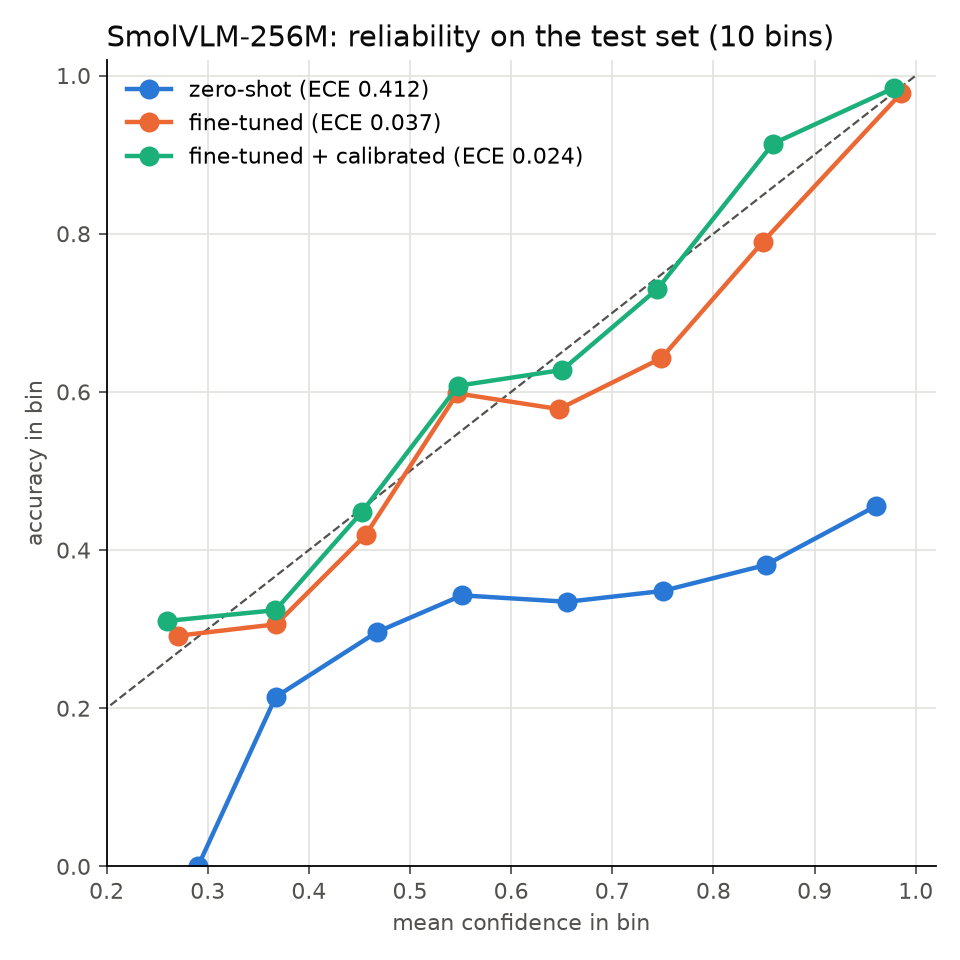

# SmolVLM-256M as a vision decision model

**A 256M vision model that answers ~50 questions a second and gets 76.5% right.**

[SmolVLM-256M-Instruct](https://huggingface.co/HuggingFaceTB/SmolVLM-256M-Instruct), fine-tuned for 13 minutes to *pick* an
answer in one forward pass instead of writing one. Given an image, a question and a list of options, it returns one option
plus a calibrated probability for every option.

**[Watch it answer real test questions →](https://krtadev.github.io/smolvlm-decision-model/)** &nbsp;·&nbsp;
[40 sampled examples](https://krtadev.github.io/smolvlm-decision-model/examples.html)

Inspired by [Jev](https://letsdatascience.com/news/typesafe-ai-launches-jev-decision-model-889a38c0), TypeSafe AI's text
decision model: the same idea, applied to images and a much smaller model.

## Results

ScienceQA test split, the 2,017 questions that come with an image.

| | Accuracy | Calibration error (ECE) |
|---|---|---|
| Random guess | 35.5% | |
| Zero-shot | 39.0% ± 2.1 | 0.412 |
| **Fine-tuned** | **76.5% ± 1.8** | 0.037 |
| Fine-tuned + temperature (T = 1.33) | 76.5% ± 1.8 | **0.024** |
| Fine-tuned, every image blanked | 58.5% | |

- Stable under option shuffling: 75.6% to 77.1% across three option orders.
- The image matters: blanking it costs 18 points.
- Speed: ~50 questions/s on one NVIDIA L4 (batches of 32, image preprocessing included).
- Weak spots: natural science (67% vs 92% social science) and five-option questions (26%, only 38 test rows).

<p align="center"></p>
<p align="center">
  
  
</p>

## How it works

1. The prompt is the image, the question and lettered options (`A) … B) …`), ending at `Assistant:`.
2. One forward pass. At the last position, take the language model's scores for the tokens `" A"` … `" E"`, using the
   frozen rows of its output layer.
3. Invalid letters are masked, and a softmax over the rest gives one probability per option. The highest is the decision.
4. Training is plain cross-entropy on that softmax, with options reshuffled every batch so letter position carries no signal.
5. A single temperature, fitted on held-out validation data, calibrates the probabilities.

No text is generated, so there is nothing to parse, the answer is always a valid option, and the cost is a single prefill.

## Setup

| | |
|---|---|
| Base model | `HuggingFaceTB/SmolVLM-256M-Instruct`, images at 512 px (64 image tokens) |
| Trainable | LoRA rank 16, alpha 32 on q/k/v/o/gate/up/down of the text model: 4.9M parameters (1.9%). Vision encoder frozen |
| Data | ScienceQA rows with an image: 6,218 train · 500 validation (checkpoint choice) · 1,597 validation (temperature) · 2,017 test |
| Optimiser | AdamW, lr 1e-4, batch 16, 20-step warmup then linear decay; early stopping on validation loss |
| Result | best checkpoint at step 500 (~1.3 epochs); 13 min of training on one L4 |

## Repository

```
index.html            animated results page + research note (GitHub Pages)
examples.html         40 sampled test questions with the model's probabilities
src/
  phase1_smolvlm.py   setup sweep, zero-shot baseline, LoRA training, calibration, test (GPU)
  run_all.sh          the runs as launched on Colab
  make_assets.py      figures and pages from a finished run (CPU)
  templates/          HTML templates for the two pages
results/
  results.json        every metric: by subject, grade, option count, option order, reliability bins
  logits.npz          option logits for the calibration and test sets
  run.log             training log
  figures/            accuracy, loss curve and reliability plots
model/adapter/        the trained LoRA adapter (PEFT format, 19 MB)
```

## Use the adapter

```python
import torch
from peft import PeftModel
from PIL import Image
from transformers import AutoModelForImageTextToText, AutoProcessor

BASE = "HuggingFaceTB/SmolVLM-256M-Instruct"
T = 1.329                                    # temperature from results/results.json
device = "cuda" if torch.cuda.is_available() else "cpu"

processor = AutoProcessor.from_pretrained(BASE)
processor.image_processor.size = {"longest_edge": 512}
model = AutoModelForImageTextToText.from_pretrained(BASE, dtype=torch.float32).to(device)
letters = [processor.tokenizer.encode(" " + c, add_special_tokens=False)[0] for c in "ABCDE"]
option_w = model.lm_head.weight[letters].detach()          # frozen rows for " A" ... " E"
model = PeftModel.from_pretrained(model, "model/adapter").eval()

def decide(image, question, choices, context=""):
    options = "   ".join(f"{'ABCDE'[i]}) {c}" for i, c in enumerate(choices))
    prompt = (f"Context: {context}\n" if context else "") + f"Question: {question}\n{options}\nAnswer:"
    messages = [{"role": "user", "content": [{"type": "image"}, {"type": "text", "text": prompt}]}]
    text = processor.apply_chat_template(messages, tokenize=False, add_generation_prompt=True)
    inputs = processor(text=[text], images=[[image]], return_tensors="pt").to(device)
    with torch.no_grad():
        hidden = model.base_model.model.model(**inputs).last_hidden_state[0, -1]
    probs = torch.softmax((hidden @ option_w.T)[: len(choices)] / T, dim=0)
    return choices[int(probs.argmax())], probs.tolist()

print(decide(Image.open("question.png").convert("RGB"), "Which animal's mouth is adapted for bottom feeding?",
             ["discus", "armored catfish"]))
```

Up to five options. Tested with `transformers` 5.x and `peft` 0.21. It reproduces the saved test probabilities on CPU.

## Reproduce

**Train (GPU; tested on a Colab L4):**

```bash
pip uninstall -y torchao            # Colab's preinstalled torchao is too old for peft 0.21
OUT_DIR=runs/r16_lr1e-4 LORA_RANK=16 LR=1e-4 IMAGE_SIDE=512 LETTER_STYLE=space python src/phase1_smolvlm.py
```

The script runs the zero-shot baseline, trains with early stopping, fits the temperature and writes `results.json`,
`logits.npz` and `adapter/` into `OUT_DIR`. With `IMAGE_SIDE=auto LETTER_STYLE=auto` it first sweeps image size and letter
tokens on the validation subset. `STAGE=finish` calibrates and tests an adapter that was stopped early.

**Build the figures and pages (CPU):**

```bash
pip install numpy matplotlib pillow datasets
python src/make_assets.py           # reads runs/*, picks the run with the lowest validation loss
```

## Credits

- Questions and images: [ScienceQA](https://scienceqa.github.io/) (Lu et al., 2022), CC BY-NC-SA 4.0. The pages embed 88
  test images for illustration.
- Base model: [SmolVLM-256M-Instruct](https://huggingface.co/HuggingFaceTB/SmolVLM-256M-Instruct) by Hugging Face, Apache 2.0.
- Idea: TypeSafe AI's [Jev](https://letsdatascience.com/news/typesafe-ai-launches-jev-decision-model-889a38c0) decision model.
